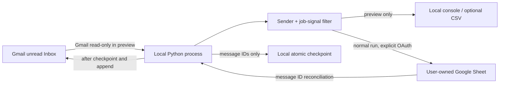

# JobMail architecture

## Runtime flow

## Boundaries

- `src/main.py` owns CLI validation, preview, filtering, and append/checkpoint order.
- `src/gmail_service.py` owns Gmail API access and scopes.
- `src/email_parser.py` extracts the supported message fields.
- `src/sheets_service.py` owns Google Sheets access and existing-row reconciliation.
- `src/state_manager.py` stores processed/pending Gmail IDs locally using atomic replacement.
- `config.py` and `.env.example` hold non-secret configuration names. OAuth credentials and tokens stay local and must never be committed.
- Email bodies are not written to Sheets or CSV by default. `--explain-matches` logs only keyword labels and is available only as an option during dry-run.
- `--replay-demo` runs the same parser/filter against bundled fictional Gmail-shaped messages using an in-memory read-only adapter. It returns before OAuth, Gmail, Sheets, or local checkpoint access.

## ADR-001: local-first Gmail to user-owned Sheets

**Decision:** Keep the first release as a local CLI. Gmail access is read-only by default for both preview and normal runs; `--mark-read` explicitly requests the broader modify scope. Store only message IDs in local recovery state. Use a user-owned Sheet as the destination rather than building hosted accounts or a new database.

**Reason:** The current code and README already provide a Gmail-to-Sheets workflow; local execution avoids collecting inbox data on a new server and keeps provider credentials out of a SaaS backend.

**Trade-offs:** Setup needs a Google Cloud OAuth client, users need Python and their own Sheet, local state must be backed up by the user, and there is no hosted dashboard or automatic cross-device sync. A paid offer should start as opt-in setup/support and only expand after buyer interviews.

**Rejected for now:** Hosted Gmail ingestion, background email sending, resume scoring AI, and shared accounts. Each would increase privacy, security, and operating obligations without validated demand.

## Failure and recovery

1. Preview with `python src/main.py --dry-run` before any write.
2. If a Sheet append succeeds but local checkpointing is interrupted, pending message IDs are reconciled against the sheet's `Gmail message ID` column before retrying.
3. Keep Gmail's unread label by default. Remove it only when the user selects `--mark-read`, after the checkpoint is saved.
4. Keep `.env`, OAuth credentials, token files, generated CSV exports, and checkpoints out of Git. Revoke OAuth access in the Google account when the user stops using the tool.

No hosted API, account system, billing service, or production monitoring is part of this architecture.

## ADR-002: SaaS beta without hosted Gmail ingestion

**Decision:** Add a separate Django application under `saas/` for accounts, user-entered job applications, export/delete, and optional Razorpay subscriptions. Keep the existing Gmail → Sheets client running locally. Do not store Gmail OAuth refresh tokens, message bodies, or inbox data in the SaaS.

**Reason:** JobMail's existing Gmail workflow requests `gmail.readonly`, which Google classifies as a restricted scope. Server-side storage or transmission of restricted-scope data requires OAuth verification and a security assessment. A small SaaS can validate the job-search tracker workflow without taking custody of users' inboxes.

**Data boundary:** The SaaS database holds a Django user, job application fields entered by that user, subscription state, and provider event IDs. It does not hold passwords in plain text, Gmail data, card details, or payment secrets. Razorpay owns checkout and recurring payment authorization; webhook events are signature-checked over raw request bytes and deduplicated by event ID.

**Deployment:** Render web service + PostgreSQL are described in `render.yaml`. Local development uses SQLite. Production secrets, a verified sender, database backups, and Razorpay plan/test keys are owner-controlled setup items. Live billing is opt-in through `RAZORPAY_MODE=live` and `LIVE_BILLING_ENABLED=true`; test mode is the default.

**Limit:** This is a beta foundation, not evidence of paying demand or production launch. It currently has a basic user-entered pipeline and a proposed ₹299 monthly price. Before paid launch, validate the recurring value with job seekers, implement the paid benefits that survive that validation, have legal terms/privacy reviewed, test the full Razorpay lifecycle, and confirm operational restore procedures.
