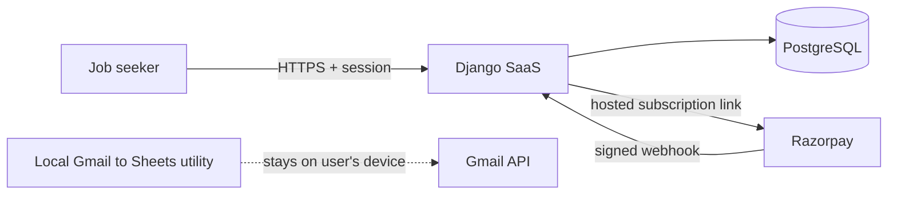

# JobMail SaaS foundation: launch gates

## Product hypothesis

Job seekers need one private place to track applications and decide what to follow up on. The first beta tests this manually entered workflow without Gmail permissions. A proposed ₹299/month Pro tier removes the 25-application cap; it is not validated pricing. Stop or re-scope the paid tier if repeated buyer interviews do not confirm recurring value.

## Implemented locally

- Django account signup, signed email activation, login, and password reset routes.
- Owner-scoped job pipeline with create/edit/delete, statuses, follow-up dates, and CSV export.
- Free beta cap, subscription records, hosted Razorpay subscription link flow, signature-verified webhook intake, and event deduplication.
- Privacy/terms summary, health endpoint, robots, sitemap, responsive landing/dashboard, deployment blueprint, and CI checks.

## Not verified / not implemented

- No production SaaS host, SMTP sender, real user, buyer, subscription, or revenue.
- Google OAuth consent verification and restricted-scope security assessment; SaaS inbox sync is deliberately excluded.
- No scheduled follow-up emails, central LeadHub sync, admin revenue analytics, team accounts, paid-feature entitlement beyond the application cap, or Sentry connection.
- No automatic database backups or restore drill; Sentry integration is present but needs an owner DSN.
- Legal pages are a product summary, not jurisdiction-reviewed legal documents.
- No current UX browser run or mobile/accessibility audit against a running production service.

## Architecture and data model

Tables: Django user; `JobApplication` (user-owned, indexed by status/update time); `BillingSubscription` (provider reference and state); `BillingEvent` (unique provider event ID); `MarketingPreference` (unchecked unless user opts in). No Gmail or card data is stored.

## Launch gates

1. Founder validates customer segment and recurring pain in at least 5 buyer conversations; pick the actual paid feature and price from evidence.
2. Founder supplies a domain, verified transactional email sender, and legal business/contact details; legal/privacy/terms get professional review.
3. Founder deploys the Render Blueprint and verifies HTTPS, production settings, SMTP activation/reset, health, and database connectivity.
4. Configure Razorpay test plan and test keys. Verify new subscription, activated, failed/pending, halted, cancellation, duplicate/out-of-order webhooks, and billing email. Confirm displayed price matches provider plan.
5. Set up automated database backups, complete a restore drill, configure alerting/error tracking, and prove account/data deletion behavior.
6. Only after all proof and owner approval: configure live payment credentials and set `RAZORPAY_MODE=live`, `LIVE_BILLING_ENABLED=true` in the founder service dashboard.
7. Do not promise automatic Gmail sync until Google OAuth verification and any restricted-scope assessment are complete. Keep local mode as the supported integration until then.

## Decisions

- No company GitHub or company services are in scope.
- Email body, Gmail refresh tokens, and mailbox content stay outside SaaS storage.
- Local CLI remains available; SaaS is a separate beta surface.
- Razorpay is selected for the India-first subscription prototype; checkout is test-mode by default.
- No live charge, buyer, or revenue is represented as complete without provider evidence.
